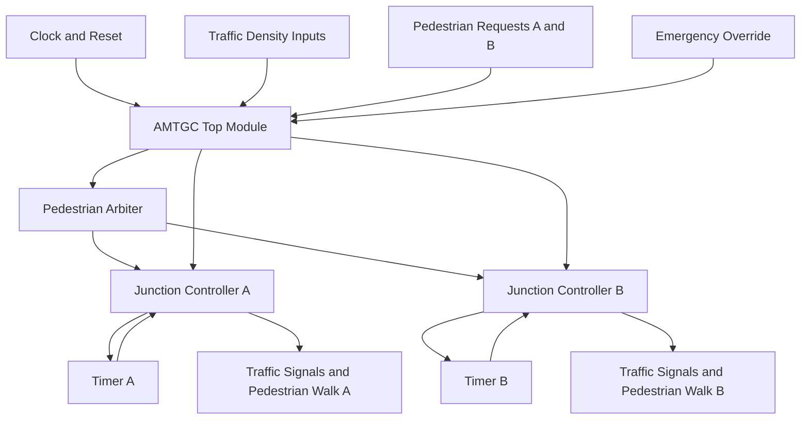

# AMTGC System Architecture

## 1. Overview

The Adaptive Multi-Junction Traffic Grid Controller (AMTGC) consists of two interconnected traffic junction controllers. Both junctions operate independently while sharing a pedestrian request arbitration mechanism.

The system supports adaptive green timing, pedestrian priority, and emergency vehicle override.

## 2. Architecture Block Diagram



## 3. Main Components

### AMTGC Top Module
- Integrates both junction controllers.
- Receives traffic density inputs.
- Receives pedestrian requests.
- Distributes emergency override signals.

### Junction Controller
- Controls north-south and east-west traffic signals.
- Implements the traffic signal state machine.
- Adjusts green duration according to traffic density.
- Controls pedestrian walk signals.

### Generic Timer
- Provides timing support for signal transitions.
- Counts clock cycles.
- Generates a completion signal when the target duration is reached.

### Pedestrian Arbiter
- Handles pedestrian requests from both junctions.
- Provides fair access when both junctions request pedestrian service.
- Uses acknowledgement signals to manage completed requests.

## 4. Emergency Override

When emergency override is activated, the system forces the traffic signals into an all-red safety condition according to the controller implementation.

## 5. Adaptive Traffic Timing

Green signal duration is adjusted according to traffic density, subject to minimum and maximum green-time limits.

The verified Task 5 configuration produced these results:

| Traffic Density | Green Duration |
|---:|---:|
| 0 | 10 cycles |
| 1 | 13 cycles |
| 3 | 19 cycles |
| 5 | 25 cycles |
| 7 | 30 cycles |

## 6. Conclusion

The architecture combines modular RTL design, independent junction control, shared pedestrian arbitration, adaptive timing, and emergency handling to provide an integrated traffic control system.
```

Press **Ctrl + S** to save.

Reply **DONE** when saved.