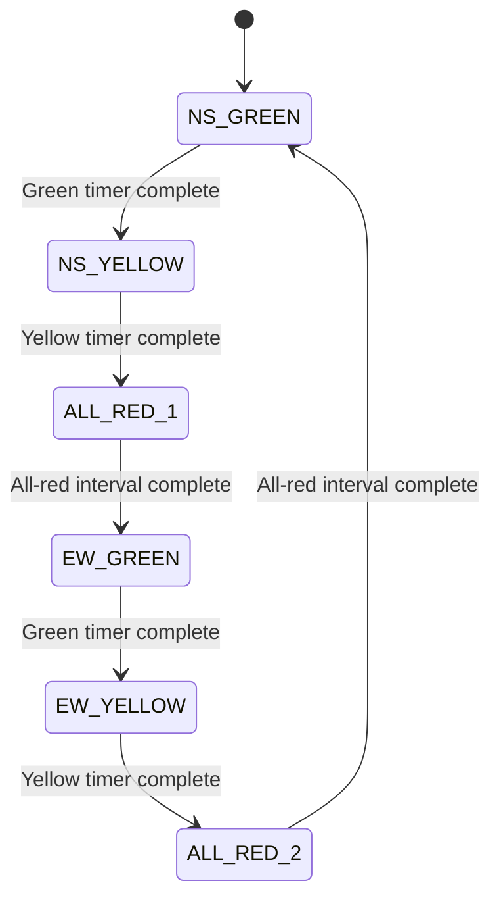

# AMTGC Junction Controller FSM

## 1. Introduction

The Junction Controller uses a Finite State Machine (FSM) to control traffic signals and pedestrian crossing operations.

The controller contains eight states.

## 2. FSM State Definitions

| State | Encoding | Description |
|---|---:|---|
| NS_GREEN | 0 | North-South traffic has a green signal |
| NS_YELLOW | 1 | North-South traffic has a yellow signal |
| ALL_RED_1 | 2 | All traffic signals are red |
| EW_GREEN | 3 | East-West traffic has a green signal |
| EW_YELLOW | 4 | East-West traffic has a yellow signal |
| ALL_RED_2 | 5 | All traffic signals are red |
| PED_NS | 6 | North-South pedestrian crossing phase |
| PED_EW | 7 | East-West pedestrian crossing phase |

## 3. Main Traffic Signal Sequence

## 4. Pedestrian States

The controller also includes two pedestrian service states:

- **PED_NS:** Provides the pedestrian crossing phase associated with the north-south direction.
- **PED_EW:** Provides the pedestrian crossing phase associated with the east-west direction.

Pedestrian state entry depends on the pedestrian request, arbiter grant, and controller transition conditions.

## 5. Emergency Override

Emergency override activates the all-red safety behavior as implemented in the controller.

## 6. Reset Operation

On reset, the controller returns to its initial state as defined in the RTL implementation.

## 7. Conclusion

The FSM provides an organized way to control traffic signal transitions, pedestrian service, and emergency safety behavior.
